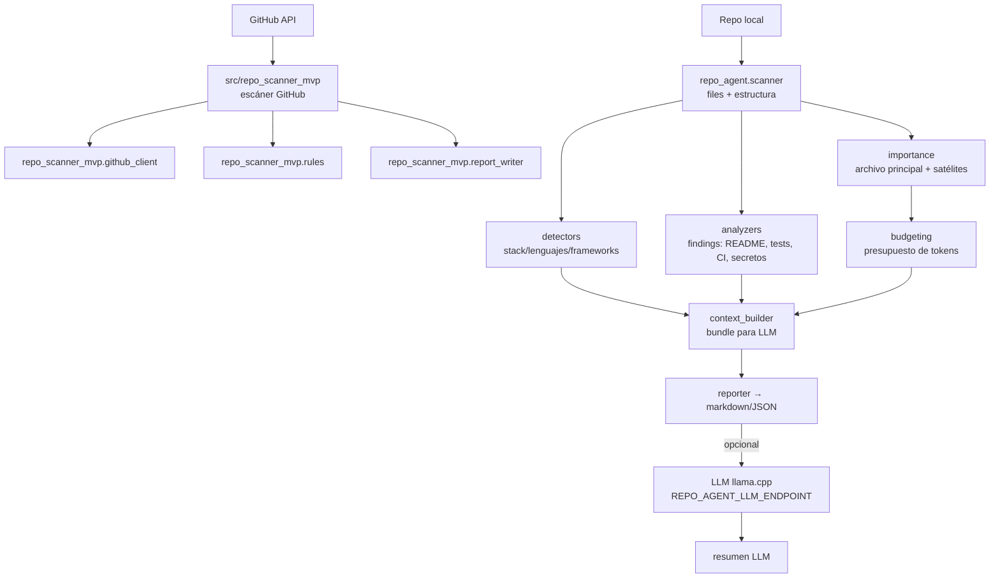

# repo-analyzer — Repo Agent MVP

MVP funcional para diagnosticar repositorios locales y preparar un paquete de contexto útil para un LLM. Incluye además un escáner de repos de GitHub con reporte de estado/riesgo por repo.

[](https://github.com/bi0punk/repo-analyzer/actions/workflows/ci.yml)
[](https://www.python.org/)
[](LICENSE)

## Contenido

- [Características](#características)
- [Arquitectura](#arquitectura)
- [Stack](#stack)
- [Estructura del repositorio](#estructura-del-repositorio)
- [Instalación](#instalación)
- [Uso](#uso)
- [Configuración](#configuración)
- [Tests / CI](#tests--ci)
- [Roadmap](#roadmap)
- [Licencia](#licencia)

## Características

### Analizador de repos locales

- Estructura general del repo y vista previa del árbol de directorios.
- Tecnologías, frameworks y lenguajes principales por extensiones.
- Tipo de proyecto sugerido.
- CI detectado o ausente; README real vs. README generado.
- Presencia de tests, `.gitignore` y `.env.example`.
- Archivos más grandes considerados; detección de `app.py` sobredimensionado.
- Sospecha simple de secretos hardcodeados y artefactos comprimidos dentro del repo.
- Selección del archivo principal para contexto LLM bajo presupuesto de tokens.
- Hasta 2 archivos satélite opcionales dentro del presupuesto.
- Resumen LLM opcional vía endpoint OpenAI-compatible (llama.cpp).

### Escáner de repos de GitHub

- Recorre los repos de un owner en GitHub y genera reporte de estado/riesgo por repo.
- Configurable por token, owner, modo de escaneo, allowlist y límites de paginación.

## Arquitectura



Salidas generadas por el analizador:

- `repo_diagnostic.md` y `repo_diagnostic.json`
- `llm_project_brief.json`, `llm_prompt.txt`, `llm_antecedents.md`
- `llm_context_bundle.json`, `llm_context_prompt.txt`
- `important_file_summary.md`

## Stack

- Python 3.12+
- Biblioteca estándar (análisis local sin deps pesadas)
- `requests` + `python-dotenv` (escáner GitHub)
- LLM opcional vía endpoint OpenAI-compatible (llama.cpp)
- Calidad: ruff (lint), mypy (typecheck), pytest

## Estructura del repositorio

```
repo-analyzer/
├── analyze_repo.py             # Entry point del analizador local
├── main.py
├── repo_agent/
│   ├── analyzers.py            # Findings (README, tests, CI, secretos, …)
│   ├── budgeting.py            # Presupuesto de tokens
│   ├── cli.py                  # CLI (repo-analyze)
│   ├── context_builder.py      # Bundle para LLM
│   ├── detectors.py            # Stack/lenguajes/frameworks
│   ├── importance.py           # Archivo principal + satélites
│   ├── llm.py                  # Resumen LLM opcional
│   ├── models.py
│   ├── prioritizer.py
│   ├── reporter.py             # Reportes markdown/JSON
│   └── scanner.py              # Escaneo de estructura
├── src/repo_scanner_mvp/       # Escáner de repos de GitHub
│   ├── cli.py                  # CLI (repo-scan)
│   ├── config.py
│   ├── github_client.py
│   ├── llm_client.py
│   ├── models.py
│   ├── report_writer.py
│   ├── rules.py
│   ├── scanner.py
│   └── utils.py
├── run_demo.sh                 # Ejecuta análisis de demo
├── run_scan.sh                 # Ejecuta escáner GitHub
├── tests/                      # 39 tests
├── .github/workflows/ci.yml
├── .env.example
├── pyproject.toml
├── LICENSE
└── README.md
```

## Instalación

```bash
python3 -m venv .venv
source .venv/bin/activate
pip install -e ".[dev]"
```

## Uso

### Analizar un repo local

```bash
python3 analyze_repo.py /ruta/a/tu/repositorio --output-dir ./output --print-report
```

O bien:

```bash
./run_demo.sh /ruta/a/tu/repositorio
```

### Ejemplo con control del presupuesto LLM

```bash
python3 analyze_repo.py ~/Documentos/atacamahub_web \
  --output-dir ./output \
  --print-report \
  --llm-max-input-tokens 24000 \
  --important-file-budget-ratio 0.35 \
  --secondary-file-budget-ratio 0.10 \
  --max-secondary-files 2
```

### Opciones adicionales

```bash
repo-analyze /ruta/al/repo --tree-depth 4 --extra-exclude "legacy,vendor"
repo-analyze /ruta/al/repo --llm-summary        # fuerza resumen LLM
repo-analyze /ruta/al/repo --no-llm-summary     # desactiva resumen LLM
```

- `--tree-depth N` — profundidad máxima del árbol de estructura en el reporte.
- `--extra-exclude a,b` — directorios adicionales a excluir del escaneo (además de los defaults).
- `--llm-summary` / `--no-llm-summary` — forzar o desactivar el resumen LLM (por defecto solo se genera si `REPO_AGENT_LLM_ENDPOINT` y `REPO_AGENT_LLM_MODEL` están definidos).

### Qué hace con el archivo principal

- Detecta candidatos como `app.py`, `main.py`, `server.py`, etc.
- Prioriza señales de entrypoint, rutas, render de templates o arranque del servidor.
- Si el archivo cabe, lo mete completo en `llm_context_bundle.json`; si no, lo resume en forma estructurada.

### Cómo usar el contexto con el LLM

Toma `llm_context_prompt.txt` o `llm_context_bundle.json` y úsalo para pedir algo como:

- "redacta un README preliminar"
- "hazme antecedentes del proyecto"
- "resume el stack y la estructura actual"
- "propón quick wins y plan de refactor"
- "explica el archivo principal y sus riesgos"

### Escáner de repos de GitHub

```bash
cp .env.example .env   # completa GITHUB_TOKEN y config
./run_scan.sh scan
```

## Configuración

### LLM opcional del analizador local

```bash
export REPO_AGENT_LLM_ENDPOINT="http://127.0.0.1:8080"
export REPO_AGENT_LLM_MODEL="qwen2.5-7b-instruct"
```

Variable | Descripción
---|---
`REPO_AGENT_LLM_ENDPOINT` | URL base del endpoint OpenAI-compatible (llama.cpp server) |
`REPO_AGENT_LLM_MODEL` | Modelo a consultar |
`REPO_AGENT_LLM_API_KEY` | API key opcional del endpoint |

Si el endpoint no responde, el diagnóstico base igual se genera.

### Escáner GitHub (ver `.env.example`)

Variable | Descripción
---|---
`GITHUB_TOKEN` | Token de GitHub (PAT) |
`GITHUB_SCAN_MODE` | Modo de escaneo (`authenticated`, etc.) |
`GITHUB_OWNER` | Owner cuyos repos se escanean |
`GITHUB_INCLUDE_ARCHIVED` / `GITHUB_INCLUDE_FORKS` | Include archival/forks |
`GITHUB_PER_PAGE` / `GITHUB_MAX_REPOS` | Paginación y límite de repos |
`GITHUB_API_VERSION` / `GITHUB_API_BASE_URL` | Versión y base de la API |
`GITHUB_REPO_ALLOWLIST` | Allowlist de repos (por nombre) |
`LLM_ENABLED` | Activa el LLM opcional |
`LLM_BASE_URL`, `LLM_CHAT_PATH`, `LLM_MODEL` | Endpoint del modelo |
`LLM_TIMEOUT_SECONDS`, `LLM_TEMPERATURE`, `LLM_MAX_TOKENS` | Parámetros del LLM |
`OUTPUT_DIR` | Directorio de salida de reportes |
`REPORT_TIMESTAMP_OVERRIDE` | Sobrescribe el timestamp del reporte |

## Tests / CI

```bash
pip install -e ".[dev]"
pytest -q
ruff check .
mypy repo_agent src
```

Cobertura (39 tests):

- `tests/test_rules.py` — reglas del escáner GitHub.
- `tests/test_repo_scanner.py` — exclusión de ruido, conteos, árbol y archivos grandes.
- `tests/test_repo_importance.py` — scoring y selección de archivo principal/satélite.
- `tests/test_repo_budgeting.py` — presupuesto de tokens.
- `tests/test_repo_context_builder.py` — resumen de archivos y payload del bundle.
- `tests/test_repo_llm_cli.py` — bundle, resumen LLM y flujo CLI.
- `tests/test_repo_fixes.py` — detección unificada de tests, README raíz y entrypoints.

GitHub Actions (`.github/workflows/ci.yml`) sobre Python 3.12 con tres jobs independientes: `lint` (ruff), `typecheck` (mypy) y `test` (pytest).

## Roadmap

- [x] Diagnóstico local con selección de archivo principal y satélites bajo presupuesto
- [x] Resumen LLM opcional y bundle de contexto exportable
- [x] Escáner de repos de GitHub con reporte por repo
- [ ] Ejecutar linters y tests reales si existen (ruff, pytest, eslint, semgrep)
- [ ] Detección de dependencias y entrypoints por lenguaje
- [ ] Patch generator para quick wins seguros con validación
- [ ] Parsing AST profundo y entendimiento de reglas de negocio

Limitaciones actuales: no aplica patches automáticamente, no corre linters/tests reales del proyecto, no crea commits/PRs y no hace parsing AST profundo.

## Licencia

MIT — ver [LICENSE](LICENSE).