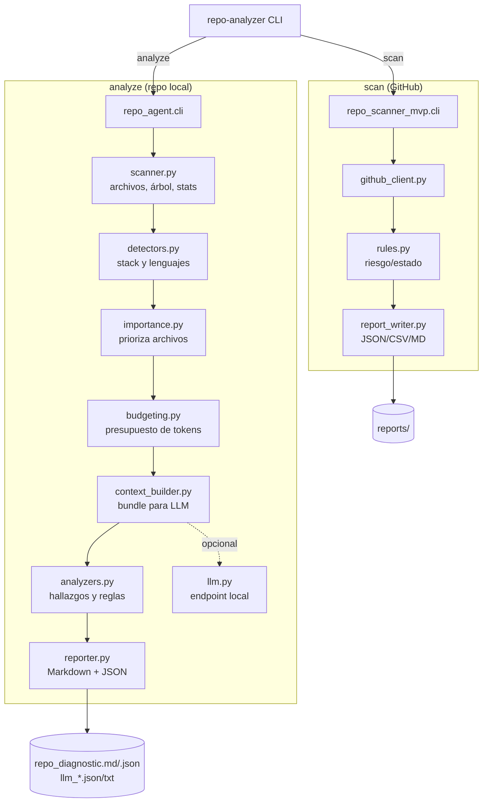

# Arquitectura

El proyecto tiene dos flujos que comparten utilidades de escaneo y reporte.

## Módulos

| Módulo | Responsabilidad |
|---|---|
| `repo_agent/cli.py` | Parser, subcomandos y códigos de salida |
| `repo_agent/scanner.py` | Recorrido de archivos, exclusiones, árbol y estadísticas |
| `repo_agent/detectors.py` | Lenguajes, frameworks, CI y tipo de proyecto |
| `repo_agent/importance.py` | Score de archivos importantes y satélites |
| `repo_agent/budgeting.py` | Estimación y reparto del presupuesto de tokens |
| `repo_agent/context_builder.py` | Payload del contexto y resumen de archivos |
| `repo_agent/analyzers.py` | Hallazgos y recomendaciones |
| `repo_agent/llm.py` | Brief y enriquecimiento opcional por LLM |
| `repo_agent/reporter.py` | Informe Markdown/JSON y artefactos |
| `src/repo_scanner_mvp/` | Escáner de GitHub (API, reglas, CSV/JSON/MD) |

## Flujo de `analyze`

1. Valida la ruta.
2. Escanea archivos (excluye `.git`, vendors, caches y `.gitignore`).
3. Detecta stack y tipo de proyecto.
4. Puntúa archivos y arma el bundle dentro del presupuesto.
5. Genera hallazgos y, si hay endpoint, un brief con LLM.
6. Escribe `repo_diagnostic.md`, JSON y artefactos de contexto.

## Decisiones

- **Sin dependencias pesadas**: solo `requests` y `python-dotenv` en runtime.
- **LLM opcional**: el análisis heurístico nunca depende de un modelo.
- **Salida reproducible**: el presupuesto de tokens es determinista; el LLM es
  un extra, no la fuente de verdad.
- **Action composite**: instala desde `github.action_path`, sin PyPI.
